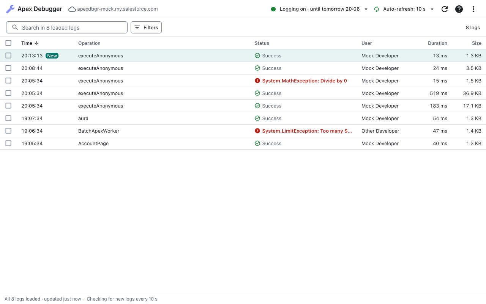
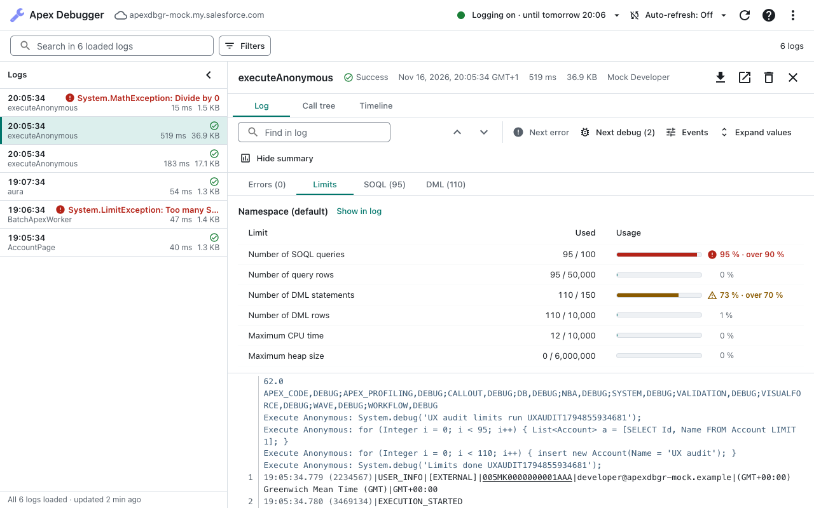
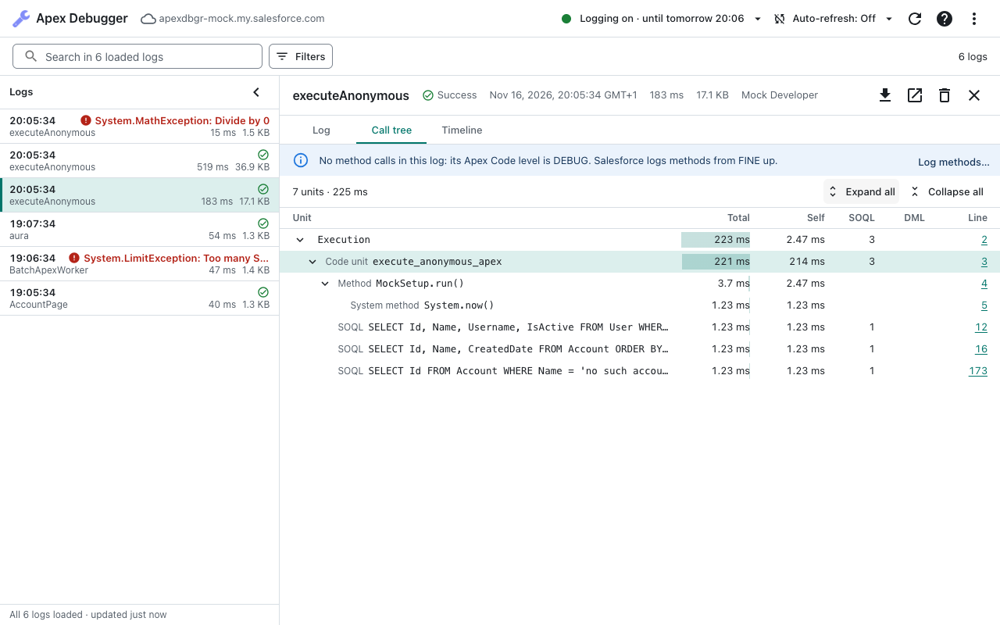
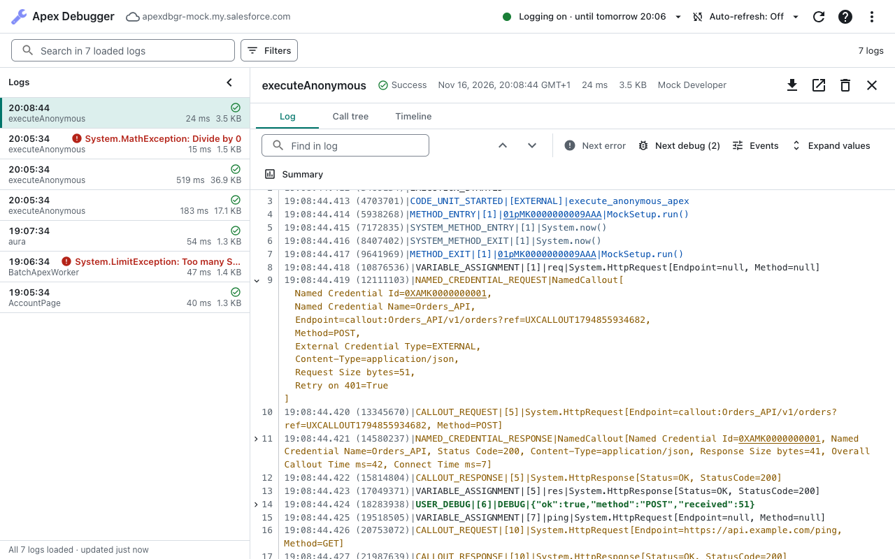
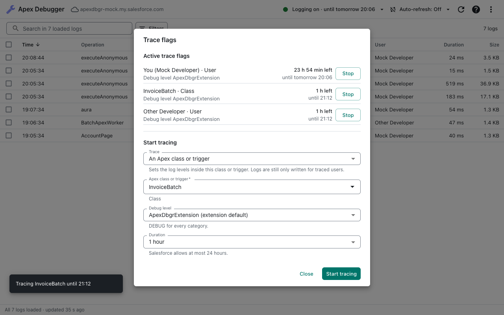
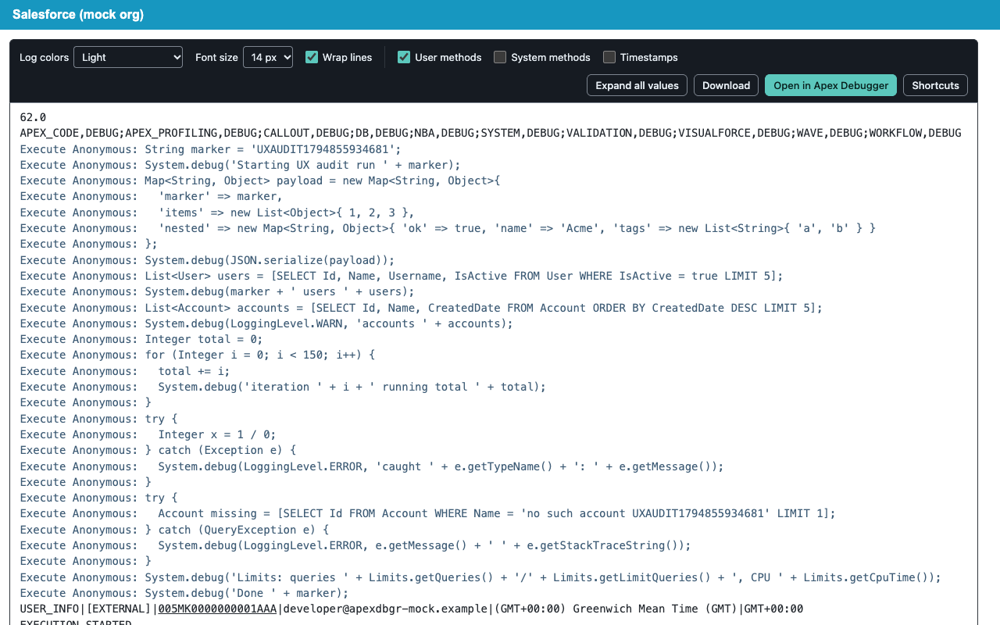

Apex Debugger
===============

Install Links
-----------------------------
[](https://chrome.google.com/webstore/detail/apex-debugger/mpckkbblhbfngaininanfjpdfjhbncjo)

Description
------------
Browser extension to read, search and analyze Salesforce Apex debug logs, with keyboard shortcuts for Salesforce setup pages.

<picture><source media="(prefers-color-scheme: dark)" srcset="docs/screenshots/1-log-list-dark.png"></picture>

Key Features
------------

  * Search in logs: find the logs whose text contains a word and filter them by operation, user or status; inside a log, find with a match counter and jump to the next error or debug line.
  * Show or hide event types (with their counts) to keep only the lines you care about.
  * Improved view of logs, with the same color palettes in the log viewer and on Salesforce's log page: Light, Dark, Monokai and High contrast, following your light or dark mode.
  * Log summary in the log viewer: governor limits per namespace, exceptions and fatal errors, SOQL queries (count, rows, time, likely queries in loops) and DML by operation and object; click an entry to jump to its line. It opens by itself for a failed run.
  * Click any Id to go to Object (Class, Trigger, Validation Rule e.t.c).
  * Indent User Debug (sObject, List, XML or JSON)
  * Expand long HTTP callout requests and responses, such as Named Credential callouts (one field per line, JSON and XML pretty-printed)
  * Call tree and timeline of a log: code units, methods, SOQL, DML, callouts and flows nested as they ran, with total and own time and SOQL/DML counts; choose one to go to its line.
  * Download the open log as a `.log` file (the full raw log, named by start time, operation and Id) for offline analyzers or tickets.
  * Delete logs: only yours, or all users', or just the logs you check in the list or the one you have open; always confirmed with the count.
  * Start, extend or stop logging (a 24-hour trace flag for the current user).
  * Trace flags: see the org's active trace flags with their expiry and stop them; trace yourself, another user (found by name), the Automated Process user or an Apex class or trigger, with the extension's debug level, one of the org's, or custom levels per category (presets Default, Apex FINEST, Quiet), for 30 minutes up to 24 hours.
  * Auto-refresh the log list (off, every 10, 30 or 60 s): new logs appear on top, marked as new, while your logging is on and the log viewer's tab is in front. Each check is one small query for the logs newer than the newest one listed.
  * Salesforce's own debug log page gets a toolbar too: log colors, font size, line wrap, timestamps, expand values, Download and "Open in Apex Debugger". The debug log list gets a body search, "Load new logs" and "Delete logs…".
  * Customizable keyboard shortcuts for Salesforce

Screenshots
-----------

| | |
|---|---|
| <picture><source media="(prefers-color-scheme: dark)" srcset="docs/screenshots/2-log-summary-dark.png"></picture> | <picture><source media="(prefers-color-scheme: dark)" srcset="docs/screenshots/3-call-tree-dark.png"></picture> |
| **Log summary**: limits, errors, SOQL and DML; likely queries in loops are flagged. | **Call tree**: what ran inside what, with time and SOQL/DML counts. |
| <picture><source media="(prefers-color-scheme: dark)" srcset="docs/screenshots/4-callouts-dark.png"></picture> | <picture><source media="(prefers-color-scheme: dark)" srcset="docs/screenshots/5-trace-flags-dark.png"></picture> |
| **Callouts**: requests and responses expanded and pretty-printed. | **Trace flags**: trace yourself, another user or a class, then stop it. |
| <picture><source media="(prefers-color-scheme: dark)" srcset="docs/screenshots/6-classic-log-page-dark.png"></picture> | |
| **Salesforce's log page**, enhanced in place. | |

Getting Started
---------------

On a Salesforce tab (Lightning, Lightning Setup or Salesforce Classic), click the Apex Debugger button in the browser toolbar, or press _Shift+W_, to open the log viewer for that org; if it's already open, its tab comes to the front. If you aren't logged in to that org, it asks you to log in first. On any other tab the button opens the extension's options. In the log viewer, choose "Start logging" so Salesforce records your Apex (for 24 hours), run your code, then refresh. A welcome page with these steps opens once, when you install the extension.

Keyboard Shortcuts
------------------

On Salesforce pages (while no field has focus):

* _Shift+W_ - Open the Apex Debugger log viewer
* _Shift+L_ - Open the newest debug log
* _Shift+D_ - Debug Logs
* _Shift+O_ - Custom Objects
* _Shift+U_ - Manage Users
* _Shift+P_ - Profiles
* _Shift+C_ - Apex Classes (see all)
* _Shift+T_ - Triggers (see all)
* _Shift+Q_ / _Shift+Z_ - Outbound / Inbound Change Sets
* _Shift+S_ - Schema Builder
* _Shift+E_ - Edit (clicks the page's Edit button)
* _Ctrl+S_ (_Cmd+S_ on macOS) - Save (clicks the page's Save button; works in a field too)

Hold Alt to open a page in the same tab (e.g. _Alt+Shift+D_).

Since 0.9, Edit and Save need a modifier: earlier versions used the bare _e_ and _s_ keys, which a stray key press could trigger. The classic debug log list has no delete key any more; "Delete logs…" always asks, with the scope (only your logs, or all users') and the count.

Change, add or remove shortcuts, or turn them off, on the extension's options page (click the toolbar button on a tab that isn't Salesforce, or follow the link under _?_ in the log viewer, which lists every shortcut). On macOS keys are shown with ⌘ ⌥ ⇧. Shortcuts you customized in earlier versions are kept; if one of yours used L or E, it keeps the key and the new built-in shortcut starts turned off.

The log viewer has its own keys (press _?_ there), and the classic debug log pages have a few single-letter keys that only change the view (listed under "Shortcuts" on the page).

Quick Demo
-----------------

[](https://www.youtube.com/watch?v=4PaQhY6tSDk)

[](https://www.youtube.com/watch?v=FuoA07dxEGI)

Standalone User Scripts (Not updated)
-----------------------------

GreaseMonkey scripts on [openuserjs](https://openuserjs.org/users/motiko/scripts)

Development
-----------------------------

The extension lives in `chrome/app`. Its scripts (service worker, content scripts, options page and the React log viewer) are TypeScript and JavaScript sources in `react/src`, built with Vite into `chrome/app/js/build/` (not committed). Build them before loading `chrome/app` as an unpacked extension:

```bash
./build.sh           # installs dependencies if needed, then builds
./build.sh --watch   # rebuild on every save
./build.sh --zip     # build and package chrome/app as apex-debugger.zip
```

Before a pull request, run the checks that CI runs (Node 24, see `.nvmrc`):

```bash
cd react
npm run lint && npm run format:check && npm run typecheck && npm test
```

The end-to-end flow also runs offline, against a mock Salesforce org (no credentials, no API requests): `cd e2e && npm install && npm run test:mock`. Against a real org (`.env.local`, logging in with the OAuth 2.0 JWT bearer flow: see [docs/e2e-jwt-setup.md](docs/e2e-jwt-setup.md)), `npm test`.

`scripts/chrome-dev.sh` builds the app if needed and starts a test Chrome with the extension loaded.

Releasing
-----------------------------

```sh
git checkout main && git pull
scripts/version.sh minor    # or patch / major: bumps chrome/app/manifest.json, commits, tags vX.Y.Z
git push --follow-tags
```

Pushing the tag runs the [release workflow](.github/workflows/release.yml):

1. It checks that the tag matches the version in `chrome/app/manifest.json`.
2. It builds the extension scripts, zips `chrome/app` and creates a GitHub release with generated notes and `apex-debugger-vX.Y.Z.zip` attached.
3. It uploads the zip to the Chrome Web Store and submits it for review ([`publish-chrome-web-store.yml`](.github/workflows/publish-chrome-web-store.yml)). The new version goes live automatically once the review passes.

The Chrome Web Store accepts no new upload while the previous version is still in review, so step 3 fails in that case. The GitHub release is created anyway. After the review finishes, publish the existing release again:

```sh
gh workflow run publish-chrome-web-store.yml -f tag=vX.Y.Z
```

The same command retries any other failed upload. Check the review state in the [Chrome Web Store Developer Dashboard](https://chrome.google.com/webstore/devconsole).

**New permissions:** if the release adds a permission to `chrome/app/manifest.json`, first add its justification in the dashboard (the item's **Privacy** tab). Otherwise the upload succeeds but submitting for review fails with `400 INVALID_ITEM_METADATA`. In that case, fill in the missing fields and click **Submit for review** in the dashboard. Don't rerun the workflow: the version is already uploaded, and the store rejects the same version twice.

If the Chrome Web Store isn't configured (see [Chrome Web Store publishing setup](docs/chrome-web-store-publishing.md)), step 3 is skipped with a warning, and you upload the zip from the GitHub release in the dashboard by hand.
